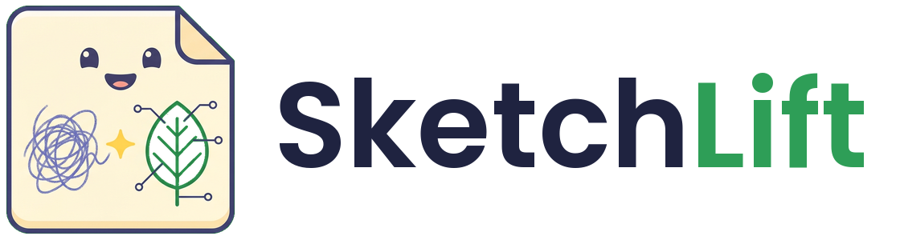
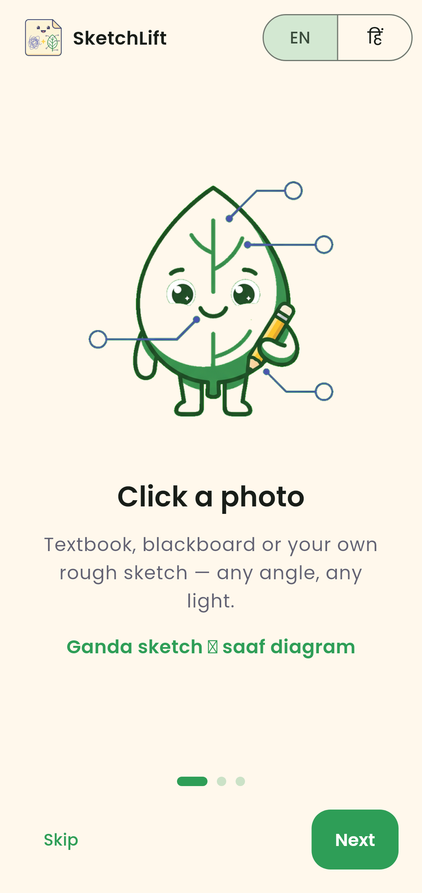
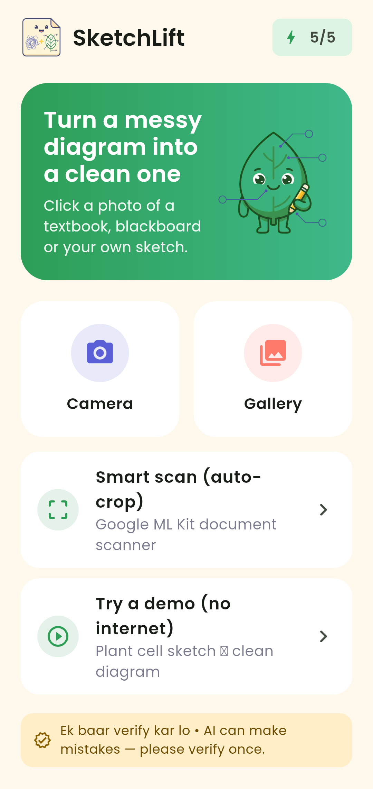
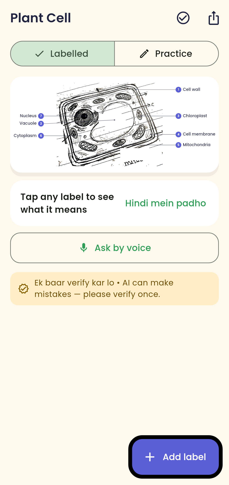
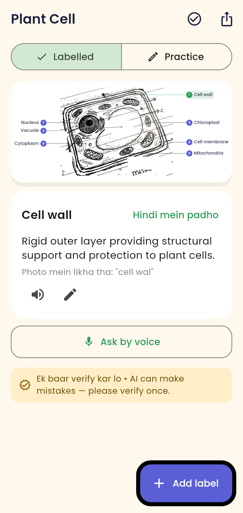
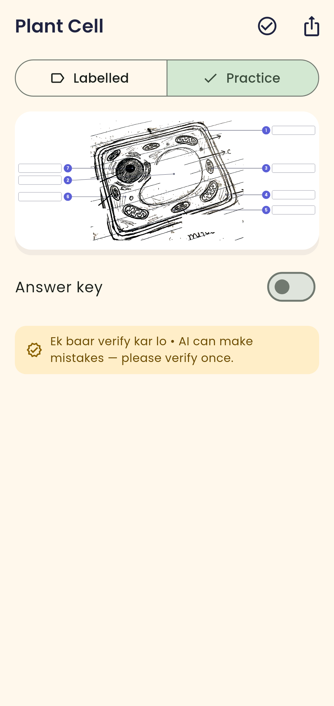
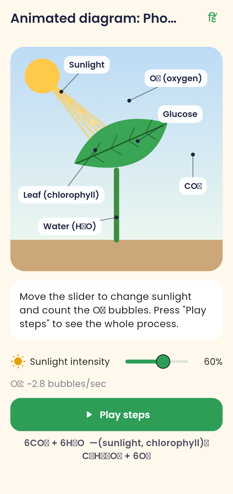
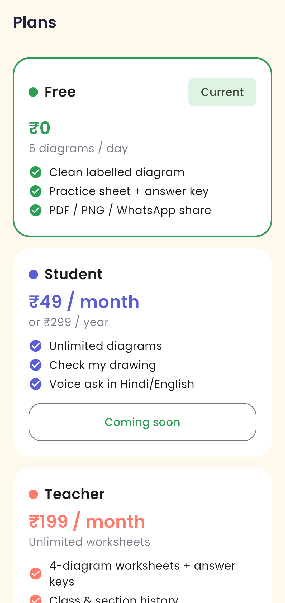
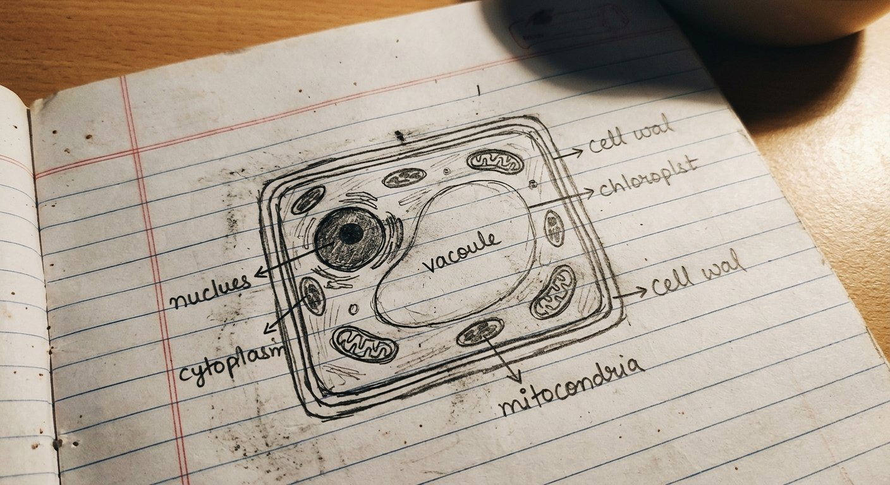
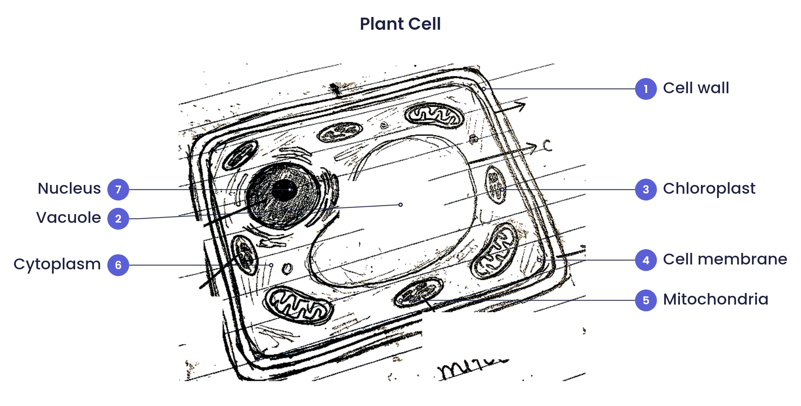

<p align="center">
  
</p>

<h3 align="center">SketchLift — messy diagram photo → clean, labelled, print-ready diagram for students</h3>

<p align="center"><i>"Ganda sketch → saaf diagram."</i> &nbsp;•&nbsp; Flutter · Android · Google Gemini · Hindi + English</p>

> Not to be confused with other projects called "SketchLift" (e.g. art/drawing tools). This SketchLift is a **study tool for Indian school students and teachers**.

A student photographs a messy diagram — an NCERT textbook page, the blackboard,
or their own rough sketch. SketchLift doesn't just apply a filter: it **understands**
the diagram with Google Gemini, then redraws it as a clean, correctly spelled,
numbered and labelled diagram that is ready to print, practise with, or share on
WhatsApp. Every label can be explained in one line in **Hindi or English**.

---

## ✨ Features

### Version 1 (core)
| # | Feature | How it works |
|---|---------|--------------|
| 1 | **Capture & clean** | Camera / gallery / **Smart scan** (Google ML Kit document scanner with auto edge detection). Fallback: a 4-corner **manual crop** with perspective correction (deskew). Then **shadow & yellow-light removal** (background division), levels/gamma, optional black-&-white, sharpening — all in pure Dart in a background isolate. |
| 2 | **AI understanding** | Gemini vision with **structured JSON output** (`responseSchema`): `is_diagram` + reason, subject, title (EN + हिंदी), diagram body box, every part with an anchor point, old-label box, one-line explanation in English and Hindi, and arrows for flow diagrams. Not a diagram → *"Ye diagram nahi lag raha"*. |
| 3 | **Spell-fix** | Bundled Biology / Physics / Chemistry / Geography glossary + Damerau-Levenshtein fuzzy matching (`mitocondria → Mitochondria`, `chloroplst → Chloroplast`). |
| 4 | **Clean output** | Old handwritten labels are erased (connected-component trick that keeps the drawing's lines), the body is cropped, and **vector labels** are drawn with a CustomPainter: clockwise numbering, leader lines and a **label-placement engine** that keeps labels outside the drawing and never overlapping (unit-tested). Pinch-zoom without blurry text. |
| 5 | **Edit in seconds** | Tap a label → rename / delete; **+ Add label** → tap the part. *"Ek baar verify kar lo"* note on every output. |
| 6 | **Practice sheet** | Same diagram with blank numbered boxes + separate answer key. |
| 7 | **Explain** | Tap a label → one-line explanation, toggle **"Hindi mein padho"**, and listen to it (TTS). |
| 8 | **Export** | Save PNG to gallery, **Print / A4 PDF** (header with name, class, date), share PNG/PDF to WhatsApp. |
| 9 | **Library** | SQLite, organised **Subject → Chapter**, with search. |

### Version 2
| # | Feature | Status |
|---|---------|--------|
| 10 | **Teacher worksheet** — pick up to 4 diagrams → blank A4 worksheet + answer-key page → print or WhatsApp | ✅ (no-account web link: clearly marked `TODO(backend)` interface `WorksheetLinkPublisher`, needs Firebase/Supabase) |
| 11 | **"Meri drawing check karo"** — photo of your own drawing is compared with a saved reference → score out of N, missing / misplaced parts, encouraging feedback (HI/EN) | ✅ |
| 12 | **Animated Photosynthesis** — light-intensity slider increases O₂ bubbles; labelled sunlight / leaf / CO₂ / O₂ / water / glucose; step-by-step play | ✅ |
| 13 | **Voice ask** — mic → "iska naam kya hai?" → Gemini answer spoken in Hindi (hi-IN) or English | ✅ |
| 14 | **Teacher dashboard** (local) — classes/sections, monthly worksheet history chart | ✅ |
| 15 | **Print-shop bulk mode** — pick many photos → batch process → one combined PDF | ✅ |
| 16 | **Plans** — Free 5/day (local counter, configurable), Student ₹49/mo or ₹299/yr, Teacher ₹199/mo, School ₹5k–15k/yr — "Coming soon" | ✅ UI only, no payments |

Plus: an **offline demo** (bundled sketch + a recorded real Gemini answer) so the app can be shown without internet, animated 3-screen onboarding, Hindi/English UI.

## 📸 Screenshots

| Onboarding | Scan | Clean diagram | Tap to explain |
|---|---|---|---|
|  |  |  |  |

| Practice sheet | Animated photosynthesis | Plans |
|---|---|---|
|  |  |  |

**Before → after** (real pipeline + real Gemini answer):

| Student's photo | SketchLift output |
|---|---|
|  |  |

_Screenshots are rendered by `test/screenshots_test.dart` (golden tests). Add real-device screenshots here later._

## 🏗️ Architecture

```
lib/
├── app_config.dart          ← app name, proxy URL, model, limits (ONE place)
├── main.dart                ← loads settings → onboarding or HomeShell
├── theme.dart               ← Material 3 theme (cream, leaf green, soft indigo)
├── l10n/strings.dart        ← tiny EN/HI i18n (context.tr('key'))
├── state/app_state.dart     ← ChangeNotifier + InheritedNotifier (settings, key, daily counter)
├── models/
│   ├── diagram.dart         ← DiagramResult/Part/Arrow/DrawingCheck + defensive JSON parsing
│   └── diagram_doc.dart     ← AI result + cleaned picture
├── services/
│   ├── image_pipeline.dart  ← deskew, whitening, sharpen, label erase, body crop (pure Dart)
│   ├── gemini_prompts.dart  ← all prompts + JSON schemas
│   ├── gemini_service.dart  ← own-key or proxy transport, friendly errors
│   ├── diagram_pipeline.dart← photo → clean → Gemini → glossary → DiagramDoc
│   ├── glossary.dart        ← subject terms + fuzzy spell-fix
│   ├── label_layout.dart    ← label placement engine (pure, unit-tested)
│   ├── library_db.dart      ← sqflite: diagrams, classes, worksheets
│   ├── export_service.dart  ← PNG / PDF / print / share (+ WorksheetLinkPublisher TODO)
│   └── voice_service.dart   ← speech_to_text + flutter_tts
├── widgets/                 ← DiagramScene (shared painter for screen/PNG/PDF), DiagramView, common
└── screens/                 ← scan, crop, processing, result, library, practice, check drawing,
                               photosynthesis, teacher (worksheet, dashboard), bulk, plans, settings
proxy/                       ← Vercel Edge Function that holds the Gemini key (free tier)
tool/                        ← live_test.dart (real pipeline + Gemini from CLI), rename_app.dart
test/                        ← unit tests + screenshot goldens
```

**Data flow:** photo → `processPhoto` (isolate) → JPEG → Gemini (structured JSON) →
`DiagramResult` → glossary fix → `cleanBody` (erase old labels, crop) →
`DiagramScene` (layout engine + painter) → screen / PNG / PDF.

### The label placement engine (interview notes)
1. Number parts **clockwise from 12 o'clock** around the body centre (exam style).
2. Put each label in the **left or right column** by which half its anchor is in; rebalance if one side is crowded (move the anchors nearest the centre line).
3. In each column every label wants to sit at its anchor's height. Sort, then a **forward sweep** pushes labels down to clear the previous one; if the column overflows, a **backward sweep** pulls them up. Order never changes → neighbouring leader lines don't cross.
4. The canvas grows to fit the widest label per side and the tallest column → nothing is ever clipped.

`test/label_layout_test.dart` checks: no label overlaps the body, no two labels overlap, all on canvas, numbering is a permutation, order preserved — including a 200-case random property test.

### Erasing old labels without cutting the drawing
Gemini's label boxes are approximate. Inside a slightly enlarged box we flood-fill the dark ink: blobs that **touch the box edge** continue outside it (cell wall, outlines) and are kept; blobs **fully inside** are letters and are erased.

## 🔑 AI access: free server or your own key

* **Default (no setup):** the app calls the SketchLift proxy (`proxy/`, Vercel), which holds the Gemini key server-side. 5 free AI calls per phone per day; the app also keeps its own daily counter (Settings → Advanced to change it).
* **Your own key (unlimited for you):** get a free key at **[Google AI Studio](https://aistudio.google.com/app/apikey)** → *Get API key*, then paste it in **Settings → Use my own Gemini key**. It is stored with `flutter_secure_storage` (Android Keystore-encrypted) and never leaves the phone except to Google.
* **Developers:** `--dart-define=GEMINI_API_KEY=...` (never commit keys), `--dart-define=PROXY_URL=...`, `--dart-define=GEMINI_MODEL=...`.

Default model: `gemini-3.8-flash` (changeable in Settings → Advanced).

## 🛠️ Setup & build

```bash
flutter pub get
dart run flutter_launcher_icons          # app icon (adaptive)
dart run flutter_native_splash:create    # splash
flutter analyze
flutter test                              # unit tests
flutter test --update-goldens test/screenshots_test.dart   # regenerate screenshots
flutter build apk --release               # universal APK
flutter build apk --release --split-per-abi   # smaller per-CPU APKs
```

Release signing: create `android/key.properties` (git-ignored) pointing to your keystore:
```
storePassword=...
keyPassword=...
keyAlias=sketchlift
storeFile=/absolute/path/to/sketchlift-release.jks
```
Without it, release builds are signed with the debug key.

Try the AI from the command line with the real pipeline:
```bash
dart run tool/live_test.dart assets/demo/plant_cell_photo.jpg /tmp/out.json
```

## 🧰 Tech stack
Flutter 3.47 / Dart 3.13 · Material 3 · Google Gemini API (REST, structured output) ·
`image` (pure-Dart image processing) · `google_mlkit_document_scanner` · `image_picker` ·
`sqflite` · `pdf` + `printing` · `share_plus` · `gal` · `speech_to_text` · `flutter_tts` ·
`flutter_secure_storage` · `shared_preferences` · Vercel Edge Functions (proxy).

## 🗺️ Roadmap
- [ ] Shareable no-account worksheet links (Firebase/Supabase storage + QR code)
- [ ] Server-side daily limit in Vercel KV / Upstash (current proxy counter is per-instance)
- [ ] Payments for Student / Teacher / School plans (Razorpay / Play Billing)
- [ ] More animated diagrams (heart, digestion, water cycle, electric circuit)
- [ ] On-device OCR pre-pass to tighten label boxes; ruled-line removal for dark notebook lines
- [ ] Devanagari font in PDFs for Hindi explanations
- [ ] iOS build

## 👩‍💻 Author
**Tanveer Ansari** — Diploma in Computer Science, Government Polytechnic College, Kota (Rajasthan).

Licensed under the [MIT License](LICENSE). Poppins font © Indian Type Foundry (SIL OFL 1.1). AI by Google Gemini — always verify AI output (*ek baar verify kar lo*).
